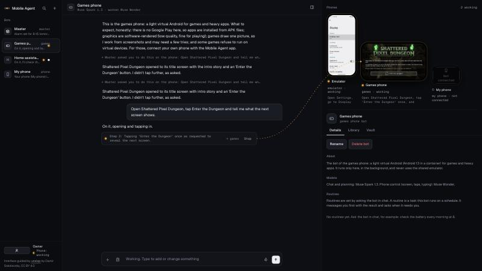
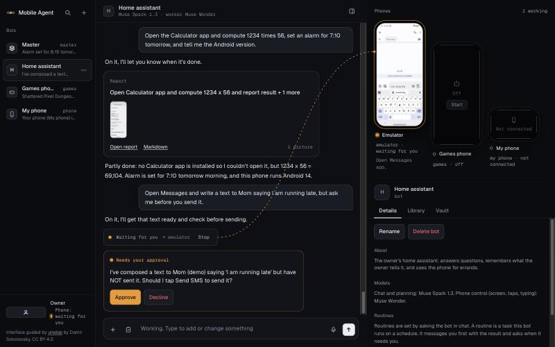
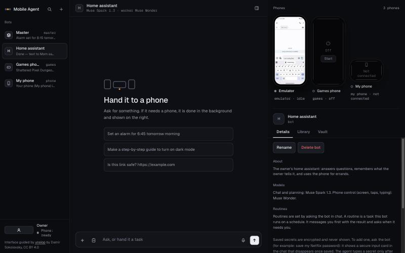
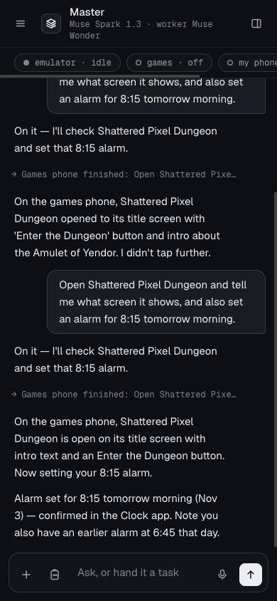
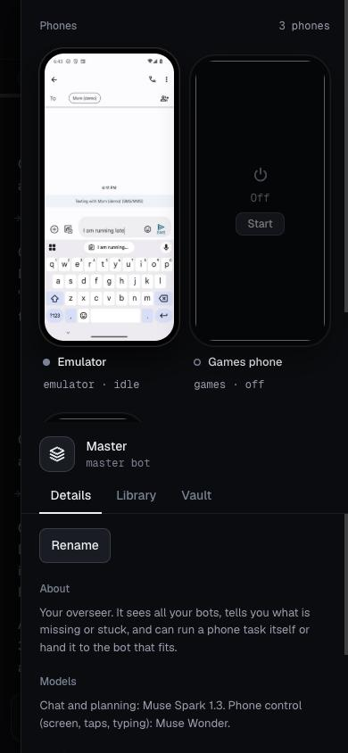
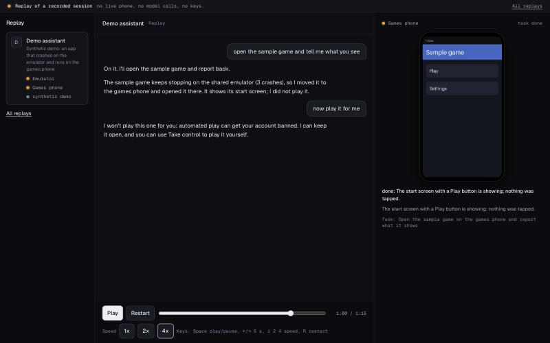

# Mobile Agent

**An always-on assistant with its own Android phones. It picks the phone that can do the job, finds another way when one fails, and protects you from itself.**

Built for the Meta Global AI Developer Hackathon (Indie Developer track, 27 Oct to 4 Nov 2026). All code in this repository is new work from the event. MIT licensed.

- Demo video (3 min): [VIDEO_URL](VIDEO_URL)
- Replay it in your browser, no phone and no keys needed: [REPLAY_URL](REPLAY_URL)

## What it does

You talk to a chat (text, microphone, or a picture you paste or drop). The orchestrator (Muse Spark) answers, remembers, and decides when a task needs a phone.
Phone work runs in the background on a queue; the phone worker (Muse Wonder) reads the screen and taps, types and scrolls until the goal is met and checked.
It asks before it sends, pays or installs, never sees your passwords, and messages you first when a routine finds something.

Three kinds of phone sit behind one interface:

| Phone | What it is | Good for | Not for |
|---|---|---|---|
| **Shared emulator** | Official Android 14 emulator, Google Play, Google sign-in | Play Store installs, system apps, anything normal | Apps that refuse to run on emulators |
| **Cloud phone 2** | Redroid (Android 13 in a container) inside a Lima VM; boots in about 5 s, pauses in 0.2 s | Apps and games the emulator cannot run; free games from F-Droid | Anything that needs Google Play or Google sign-in (it has none); fast 3D (software graphics) |
| **Your own phone** | The Mobile Agent app (Kotlin, `android/`) dials out to the server and acts through Android accessibility | Genuine hardware; its own bot and chat | Invisible background work (you see it act on the screen); banking apps |

**Connectors (MCP).** Connect an app's own tools (GitHub, Linear, Notion, Hugging Face, Firecrawl, a web fetcher, or any MCP server) from the Connectors page, and the agent uses them before it reaches for the phone: faster, no screen, and it works while the phone sleeps. Anything that could change something asks you first, with the exact arguments on the card. See [docs/connectors.md](docs/connectors.md).

Each phone has its own queue, so a long task on one never blocks another. Extra `adb` phones (a USB phone, a cloud phone) can be added with `ADB_PHONES`.

## Demo scenarios

1. **It finds a way.** Ask any bot to "open Clash of Clans". The emulator crashes (the agent counts crashes and stops after 3), the app is copied to Cloud phone 2 and opened there, and one message says where it ran. Asked to *play* it, the agent refuses
   (Supercell bans bot accounts) and points you to Take control, where you play it yourself. Meanwhile an emulator task and a games-phone task run side by side.
2. **See it, say it.** <!-- confirm the calendar flow after rehearsal --> Paste a picture and say what you want with the microphone. Muse Spark reads the picture, a confirm card asks before anything is saved, Muse Wonder does it on the phone, and you can steer while it runs.
3. **Proactive and safe.** <!-- confirm after rehearsal --> A routine messages you first with a web-search brief. A sign-in uses a vault secret: an approval card, and the agent never sees the value. Text hidden inside a picture is reported, never obeyed.

## What it looks like

The right column is the bench: every phone is a lit device with its live screen. An amber lamp is lit while a phone works and hollow while it waits for you,
and a patch line runs from the running task in the chat to the phone doing it. An approval is the only other amber on screen.




| First run | Phone width (390 px) | Phone width, the bench | Replay site |
|---|---|---|---|
|  |  |  |  |

The interface is dark only (a deliberate choice for the demo). Fonts are Geist and Geist Mono (SIL OFL, in `web/fonts`), served from the app itself: nothing is loaded from outside.

## Meta models used

| Model | Job in this project |
|---|---|
| **Muse Spark 1.3** (`muse-spark-1.3`) | Orchestrator: chat, memory, routing between phones, planning and checking; web search (Responses API) for the "other ways" card; image understanding for pictures in chat |
| **Muse Wonder 1.0** (`muse-wonder-1.0`) | The phone worker: computer use over screenshots and the UI tree |
| **Muse Voice Transcribe 1.0** (`muse-voice-transcribe-1.0`) | The chat microphone |
| **Muse Image 1.0** (`muse-image-1.0`) | "Show me": a picture that explains, drawn from a prompt or edited from your picture or the phone's screen (numbered arrows on where to tap). Always labelled AI-generated; a daily cap keeps cost small |

### Open weights

OPEN_WEIGHTS_STATUS

## Architecture


A request flows: chat or app -> the bot's orchestrator -> a queued job on one phone's lane -> the worker loop (screenshot + UI tree -> one action -> verify) -> the answer back in the chat.
Details: [docs/design-v2.md](docs/design-v2.md), [docs/phone-client.md](docs/phone-client.md), [docs/virtual-android.md](docs/virtual-android.md).

## Safety design

| Rule | How it is enforced |
|---|---|
| Ask before sending, paying, installing | Approval and confirm cards in the chat; the worker stops until you answer |
| It never sees your secrets | AES-GCM vault; the model only knows labels; typed into the phone only after you approve each use, never logged or echoed |
| It never plays games that ban bots | Code-enforced guard on every phone: taps, swipes, typing and saved secrets are refused in Supercell and Niantic apps, and in a browser on a cloud-gaming page for them. Opening, installing and describing the screen stay allowed. See [docs/game-safety.md](docs/game-safety.md) |
| Text in a picture or web page is data, not orders | Prompt rule plus tests; pictures are stripped of metadata and resized before they leave your machine |
| No sign-in tokens move between phones | The vault and your approval are the only sharing mechanism; Cloud phone 2 cannot sign in at all |
| Third-party sites never get your login | The "other ways" card lists options with risks read from the sites' own pages; a pick only opens the page and hands the sign-in to you |
| Connectors cannot act on their own | Only you connect them; a tool that is not read-only waits for your yes on a card showing the exact arguments; what a tool returns is data, size-capped and never followed as orders; their keys sit in the vault under hidden labels no bot or phone job can ask for |
| Local by default | The server listens on 127.0.0.1; any other `HOST` refuses to start without `APP_TOKEN`; pairing codes are throttled |

## Honest limits

- Apps and games that detect virtual devices can still refuse to run on the emulator. The agent detects the crash, moves the app to the next phone, and says so; if none works it stops and names what is missing. It does not disguise any device.
- Cloud phone 2 has no Google Play, no Google sign-in, and software-only graphics. Apps go in as APK files (`scripts/virtual-android/install-apk.sh`).
- The real-phone app needs a manual step on Android 13 and newer: allow restricted settings, then turn on its accessibility service. The phone must be unlocked. It is a sideloaded debug build, not on Google Play (Play forbids autonomous accessibility agents).
- Supercell and Niantic games are never played by the agent, on any phone.
- Connectors sign in with a key or token only. Browser sign-in (OAuth) is not built, so Gmail, Calendar and servers that offer only OAuth are not available as connectors; the phone remains the way to use those apps.
- Phone control is local today (a Mac with the emulator). A hosted cloud phone is the deployment target; `docs/phone-client.md` and `docs/virtual-android.md` explain the options and what is not verified.
- Tested on macOS (Apple Silicon). Linux is untested.

## Connect your phone
Press **Connect a phone** in the Phones panel and scan the QR code with an Android phone: the page it opens (one-time link, local Wi-Fi only) offers the Mobile Agent app with its size and
SHA-256, then **Open in the app** pairs it. The app has a history screen (tasks the assistant ran, plus a local log of every operation: time, operation, app, never screenshots or typed text),
**Disconnect and revoke**, and a notification while it works. Build the app file once with `bash scripts/build_apk.sh`. The USB route (`adb reverse`, nothing exposed) is in
[docs/real-phone-test.md](docs/real-phone-test.md).

## Quick start

You need Python 3.11+, [uv](https://docs.astral.sh/uv/), and a Meta Model API key from [dev.meta.ai](https://dev.meta.ai).

```bash
git clone https://github.com/DharanesshMD/mobile-agent.git
cd mobile-agent
uv sync
cp .env.example .env            # then put your key in META_API_KEY
uv run python -m unittest discover -s tests     # no phone or key needed (about 80 s)
uv run python -m agent.service  # http://127.0.0.1:8000
```

Open http://127.0.0.1:8000 for the chat. Chat, memory, pictures, routines and the vault do not depend on a phone; tasks that operate a phone need one of:

| Phone | Setup |
|---|---|
| Shared emulator | [docs/local-device.md](docs/local-device.md) (Android command-line tools, one AVD); the service starts and sleeps it |
| Cloud phone 2 | `bash scripts/virtual-android/setup.sh` once (installs Lima, a small Ubuntu VM, Docker and Redroid), then [docs/virtual-android.md](docs/virtual-android.md) |
| Your own phone | [docs/real-phone-test.md](docs/real-phone-test.md) (USB debugging, about an hour) |

One-off task from the terminal, with a phone attached: `uv run python -m agent "Open Settings and tell me the battery percentage"`.
`scripts/reset_fresh.py` restores a clean first-run state; `scripts/security_sweep.py` checks the repo before it is made public.

## Measured numbers

From [docs/qa-run-2026-10-31.md](docs/qa-run-2026-10-31.md) and [docs/virtual-android-spike.md](docs/virtual-android-spike.md) (M1 Pro, 16 GB):

| What | Result |
|---|---|
| Unit and integration tests | over 400, all passing when this was written; run them with the command in Quick start |
| Live QA run, real models, through the UI | 10 of 12 scenarios pass (6 only after fixes made during the run), 1 partial (real-phone app on the emulator), 1 measured only |
| Phone step on the emulator | median 4.3 s, p90 6.4 s (61 steps); model time about 2.9 s of it |
| First chat reply | 1.3 to 3.8 s |
| Cloud phone 2: container boot, VM start | 5.5 s, 10 to 13 s (about 15 s from fully off; 24 s to a first reply in the QA run) |
| Cloud phone 2 pause and resume | 0.14 s and 0.21 s |
| Screenshot, Cloud phone 2 | 100 ms in a game, 379 ms on the launcher |
| Screen reader (uiautomator2) | 22 ms after the first call |
| Container memory | 0.6 GiB idle, 1.68 GiB with a heavy game |
| An app that crashes on the emulator | stopped after 3 crashes in 39.7 s, no retry loop |

## Project layout

| Path | What |
|---|---|
| `agent/` | The service: `orchestrator.py`, `graph.py` and `loop.py` (worker), `jobs.py` (queue lanes), `escalate.py`, `gamepolicy.py`, `vault.py`, `remote.py` (real phones), `mcp.py` and `connectors.py` (connected apps), `virtual.py` (Cloud phone 2), `images.py`, `options.py`, `chat_api.py`, `service.py` |
| `prompts/` | Orchestrator, master and worker prompts |
| `web/index.html` | The chat UI (one file, no build step) |
| `android/` | The Mobile Agent app for a real phone (Kotlin, Gradle wrapper pinned to 8.11.1) |
| `scripts/` | Emulator start, games-phone setup, reset, scenario runner, security sweep |
| `tests/` | Unit and integration tests (`python -m unittest discover -s tests`) |
| `docs/` | Design, research, QA and safety notes; start at [docs/README.md](docs/README.md) |

## License

MIT, see [LICENSE](LICENSE). Third-party notices: [NOTICE](NOTICE).

