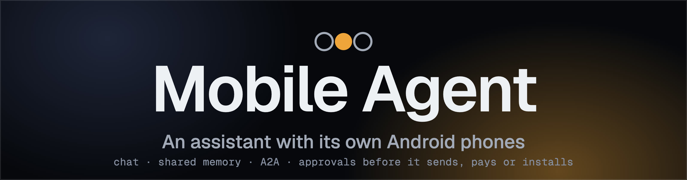

<p align="center">
  
</p>

<h3 align="center">It picks the phone that can do the job, finds another way when one fails, and protects you from itself.</h3>

<p align="center">
  <a href="https://youtu.be/psFdJ-Ajhr4"><b>Demo video (3 min)</b></a> &nbsp;|&nbsp;
  <a href="#run-it-locally-and-test-it"><b>Run it</b></a> &nbsp;|&nbsp;
  <a href="docs/docker.md"><b>Docker</b></a> &nbsp;|&nbsp;
  <a href="docs/README.md"><b>Docs</b></a> &nbsp;|&nbsp;
  <a href="docs/replay.md"><b>Replay</b></a> &nbsp;|&nbsp;
  <a href="#meta-models-used"><b>Meta models</b></a>
</p>

<p align="center">
  
  
  
  
  
</p>
<p align="center">
  
  
</p>

> Built for the Meta Global AI Developer Hackathon (Indie Developer track, 27 Oct to 4 Nov 2026). All code in this repository is new work from the event. MIT licensed.
> Replay a session in a browser, no phone and no keys needed: [docs/replay.md](docs/replay.md) (the session that ships in the repo is a synthetic demo, marked as such).

## What it does

You talk to a chat (text, microphone, or a picture you paste or drop). The orchestrator (Muse Spark) answers, remembers, and decides when a task needs a phone.
Phone work runs in the background on a queue; the phone worker (Muse Wonder) reads the screen and taps, types and scrolls until the goal is met and checked.
It asks before it sends, pays or installs, never sees your passwords, and messages you first when a routine finds something.

Three kinds of phone sit behind one interface:

| Phone | What it is | Good for | Not for |
|---|---|---|---|
| **Phone** | Android 14 with Google Play and Google sign-in | Play Store installs, system apps, anything normal | Apps that refuse to run on it |
| **Phone 2** | A second light Android 13; boots in about 5 s, pauses in 0.2 s | Apps and games Phone cannot run; free games from F-Droid | Anything that needs Google Play or Google sign-in (it has none); fast 3D (software graphics) |
| **Connected phones** | Any Android phone you connect with the Mobile Agent app (Kotlin, `android/`): it dials out to the server and acts through Android accessibility | Its own bot and chat, its own apps and accounts | Invisible background work (you see it act on the screen); banking apps |

**One-time codes.** When a task needs an SMS code that went to another of your phones, the app on that phone can find it, and you approve that one code with a click before it is typed ([docs/otp-relay.md](docs/otp-relay.md)).

**Connectors (MCP).** Connect an app's own tools (GitHub, Linear, Notion, Hugging Face, Firecrawl, a web fetcher, or any MCP server) from the Connectors page, and the agent uses them before it reaches for the phone: faster, no screen, and it works while the phone sleeps. Anything that could change something asks you first, with the exact arguments on the card. See [docs/connectors.md](docs/connectors.md).

Each phone has its own queue, so a long task on one never blocks another. Extra `adb` phones (a USB phone, BlueStacks) can be added with `ADB_PHONES`.

## Demo scenarios

1. **It finds a way.** Ask any bot to "open Clash of Clans". It crashes on Phone (the agent counts crashes and stops after 3), the app is copied to Phone 2 and opened there, and one message says where it ran. Asked to *play* it, the agent refuses
   (Supercell bans bot accounts) and points you to Take control, where you play it yourself. Meanwhile a task on Phone and a task on Phone 2 run side by side.
2. **See it, say it.** <!-- confirm the calendar flow after rehearsal --> Paste a picture and say what you want with the microphone. Muse Spark reads the picture, a confirm card asks before anything is saved, Muse Wonder does it on the phone, and you can steer while it runs.
3. **Proactive and safe.** A routine messages you first with a web-search brief. A sign-in uses a vault secret: an approval card, and the agent never sees the value. Text hidden inside a picture is reported, never obeyed.

## What it looks like

The right column is the bench: every phone is a lit device with its live screen. An amber lamp is lit while a phone works and hollow while it waits for you,
and a patch line runs from the running task in the chat to the phone doing it. An approval is the only other amber on screen.


| First run | Phone width (390 px) | Phone width, the bench | Replay site |
|---|---|---|---|
|  |  |  |  |

The interface is dark only (a deliberate choice for the demo). Fonts are Geist and Geist Mono (SIL OFL, in `web/fonts`), served from the app itself: nothing is loaded from outside.

## Meta models used

| Model | Job in this project |
|---|---|
| **Muse Spark 1.3** (`muse-spark-1.3`) | Orchestrator: chat, memory, routing between phones, planning and checking; web search (Responses API) for the "other ways" card; image understanding for pictures in chat |
| **Muse Wonder 1.0** (`muse-wonder-1.0`) | The phone worker: computer use over screenshots and the UI tree |
| **Muse Voice Transcribe 1.0** (`muse-voice-transcribe-1.0`) | The chat microphone |
| **Muse Image 1.0** (`muse-image-1.0`) | "Show me": a picture that explains, drawn from a prompt or edited from your picture or the phone's screen (numbered arrows on where to tap). Always labelled AI-generated; a daily cap keeps cost small |

### Open weights

Not claimed. An optional switch (`ORCHESTRATOR_BACKEND=baseten`, see [docs/open-weights.md](docs/open-weights.md)) can run the orchestrator on Muse Spark Open through Baseten. The code is written and unit tested against fakes, but **it was never run live** (no Baseten key was used), so this project is not entered for the open-weights bonus. Everything the demo shows runs on the Meta Model API.

## Architecture


A request flows: chat or app -> the bot's orchestrator -> a queued job on one phone's lane -> the worker loop (screenshot + UI tree -> one action -> verify) -> the answer back in the chat.
Details: [docs/design-v2.md](docs/design-v2.md), [docs/phone-client.md](docs/phone-client.md), [docs/virtual-android.md](docs/virtual-android.md).

## Safety design

| Rule | How it is enforced |
|---|---|
| Ask before sending, paying, installing | Approval and confirm cards in the chat; the worker stops until you answer |
| It never sees your secrets | AES-GCM vault; the model only knows labels; typed into the phone only after you approve each use, never logged or echoed |
| It never plays games that ban bots | Code-enforced guard on every phone: taps, swipes, typing and saved secrets are refused in Supercell and Niantic apps, and in a browser on a cloud-gaming page for them. Opening, installing and describing the screen stay allowed. See [docs/game-safety.md](docs/game-safety.md) |
| Text in a picture or web page is data, not orders | Prompt rule plus tests; pictures are stripped of metadata and resized before they leave your machine |
| No sign-in tokens move between phones | The vault and your approval are the only sharing mechanism; Phone 2 cannot sign in at all |
| Third-party sites never get your login | The "other ways" card lists options with risks read from the sites' own pages; a pick only opens the page and hands the sign-in to you |
| Connectors cannot act on their own | Only you connect them; a tool that is not read-only waits for your yes on a card showing the exact arguments; what a tool returns is data, size-capped and never followed as orders; their keys sit in the vault under hidden labels no bot or phone job can ask for |
| Local by default | The server listens on 127.0.0.1; any other `HOST` refuses to start without `APP_TOKEN`; pairing codes are throttled |

## Honest limits

- Apps and games that detect the setup can still refuse to run on a phone. The agent detects the crash, moves the app to the next phone, and says so; if none works it stops and names what is missing. It does not disguise any device.
- Phone 2 has no Google Play, no Google sign-in, and software-only graphics. Apps go in as APK files (`scripts/virtual-android/install-apk.sh`).
- The real-phone app walks you through its switches with a live checklist whose buttons open the right Settings screens (allow restricted settings on Android 13 and newer, turn on the accessibility service, notifications, battery, and on Xiaomi the Autostart, pop-up and battery-saver screens). Google Play Protect may block the install of an app with Accessibility in some countries: install it over adb instead (docs/phone-client.md). The phone must be unlocked. It is a sideloaded debug build, not on Google Play (Play forbids autonomous accessibility agents).
- Supercell and Niantic games are never played by the agent, on any phone.
- Connectors sign in with a key or token only. Browser sign-in (OAuth) is not built, so Gmail, Calendar and servers that offer only OAuth are not available as connectors; the phone remains the way to use those apps.
- Phone control is local today (the phones run on the Mac or connect to it). A hosted deployment is the target; `docs/phone-client.md` and `docs/virtual-android.md` explain the options and what is not verified.
- On some phones Google Play Protect blocks the downloaded APK ("App blocked to protect your device", because the app declares the Accessibility permission). Installing from the computer over adb (Connect a phone > Install from this computer) commonly works; see [docs/real-phone-test.md](docs/real-phone-test.md).
- Logs are local files in `data/logs/` (redacted, rotated); see [docs/logging.md](docs/logging.md).
- Tested on macOS (Apple Silicon). Linux is untested.

## Connect your phone
Press **Connect a phone** in the Phones panel and scan the QR code with an Android phone: the page it opens (one-time link, local Wi-Fi only) offers the Mobile Agent app with its size and
SHA-256, then **Open in the app** pairs it. The app has a history screen (tasks the assistant ran, plus a local log of every operation: time, operation, app, never screenshots or typed text),
**Disconnect and revoke**, and a notification while it works. Build the app file once with `bash scripts/build_apk.sh`. The USB route (`adb reverse`, nothing exposed) is in
[docs/real-phone-test.md](docs/real-phone-test.md).

## Run it locally and test it

Pick one way to run it. Both serve the same app and the same web page.

### A. Docker (nothing to install but Docker)

```bash
git clone https://github.com/DharanesshMD/mobile-agent.git
cd mobile-agent
docker compose up -d --build            # builds the image and starts the app (first build takes a few minutes)
docker compose logs mobile-agent        # prints the link: http://localhost:8000/#token=...
```

Open that link. A **Setup** window opens by itself and walks you through the rest, with nothing to edit:
1. **Model API key**: paste your Meta Model API key from [dev.meta.ai](https://dev.meta.ai). It is checked and saved in the data volume.
2. **Wi-Fi address** (only needed to pair a real phone): type this computer's address.
3. **A phone**: for the Android emulator, run `bash scripts/host-emulator.sh` in a terminal on this computer (it installs the emulator the first time, which needs Java, then starts it; the app finds it by itself within seconds). Or press **Connect a phone** to pair a real Android phone.

Chat, memory, routines, the vault and A2A work with only the key. Details, ports, backups and what runs inside Docker: [docs/docker.md](docs/docker.md). Stop it with `docker compose down` (add `-v` to also delete its data).

### B. Native (Python)

You need Python 3.11+, [uv](https://docs.astral.sh/uv/), and a Meta Model API key from [dev.meta.ai](https://dev.meta.ai).

```bash
git clone https://github.com/DharanesshMD/mobile-agent.git
cd mobile-agent
uv sync
cp .env.example .env                    # then put your key in META_API_KEY
uv run python -m agent.service          # http://127.0.0.1:8000
```

Tasks that operate a phone need one of:

| Phone | Setup |
|---|---|
| Phone | [docs/local-device.md](docs/local-device.md) (Android command-line tools, one AVD); the service starts and sleeps it |
| Phone 2 | `bash scripts/virtual-android/setup.sh` once, then [docs/virtual-android.md](docs/virtual-android.md) |
| Connected phones | [docs/real-phone-test.md](docs/real-phone-test.md) (the Mobile Agent app: scan a code or install from this computer) |

### Test it

1. **Automated tests** (no phone and no key needed, about 3 minutes, 872 tests):
   ```bash
   uv run python -m unittest discover -s tests
   ```
   The same suite runs inside the Docker image: `docker build --target test -t mobile-agent:test . && docker run --rm --entrypoint python mobile-agent:test -m unittest discover -s tests`. One test (`test_available_needs_lima_and_the_vm`) needs Lima installed on the host, so it fails inside the image; the other 855 pass.
2. **Is it up?** `curl http://127.0.0.1:8000/api/health` returns `{"ok":true,...}`. In Docker the API needs the token: `curl -H "Authorization: Bearer $(docker compose exec -T mobile-agent cat data/.app_token)" http://127.0.0.1:8000/api/bots`.
3. **Without a phone**: open the page and ask "what can you do?". Chat, memory, pictures and routines work with only the key.
4. **With a phone** (the emulator or a connected phone), try these in the chat:
   - `Open Settings and tell me which Android version this phone runs`: it opens Settings, scrolls and answers (about 3 steps).
   - `Text 5551234 that I am running ten minutes late`: it writes the text and **stops with an approval card**. Press **Decline** and nothing is sent.
5. **Without a phone at all**: play a recorded session in the browser, no keys needed: [docs/replay.md](docs/replay.md).

One-off task from the terminal, with a phone attached: `uv run python -m agent "Open Settings and tell me the battery percentage"`.
`scripts/reset_fresh.py` restores a clean first-run state; `scripts/security_sweep.py` checks the repo before it is made public.

## Measured numbers

From [docs/qa-run-2026-10-31.md](docs/qa-run-2026-10-31.md) and [docs/virtual-android-spike.md](docs/virtual-android-spike.md) (M1 Pro, 16 GB):

| What | Result |
|---|---|
| Unit and integration tests | 872, all passing; run them with the command under "Test it" |
| Live QA run, real models, through the UI | 10 of 12 scenarios pass (6 only after fixes made during the run), 1 partial (the Mobile Agent app on Phone), 1 measured only |
| Phone step on Phone | median 4.3 s, p90 6.4 s (61 steps); model time about 2.9 s of it |
| First chat reply | 1.3 to 3.8 s |
| Phone 2: first boot, cold start | 5.5 s, 10 to 13 s (about 15 s from fully off; 24 s to a first reply in the QA run) |
| Phone 2 pause and resume | 0.14 s and 0.21 s |
| Screenshot, Phone 2 | 100 ms in a game, 379 ms on the launcher |
| Screen reader (uiautomator2) | 22 ms after the first call |
| Phone 2 memory | 0.6 GiB idle, 1.68 GiB with a heavy game |
| An app that crashes on Phone | stopped after 3 crashes in 39.7 s, no retry loop |

## Project layout

| Path | What |
|---|---|
| `agent/` | The service: `orchestrator.py`, `graph.py` and `loop.py` (worker), `jobs.py` (queue lanes), `escalate.py`, `gamepolicy.py`, `vault.py`, `remote.py` (phones paired through the app), `mcp.py` and `connectors.py` (connected apps), `virtual.py` (Phone 2), `images.py`, `options.py`, `chat_api.py`, `service.py` |
| `prompts/` | Orchestrator, master and worker prompts |
| `web/index.html` | The chat UI (one file, no build step) |
| `android/` | The Mobile Agent app (Kotlin, Gradle wrapper pinned to 8.11.1) |
| `scripts/` | Phone start, Phone 2 setup, reset, scenario runner, security sweep |
| `tests/` | Unit and integration tests (`python -m unittest discover -s tests`) |
| `docs/` | Design, research, QA and safety notes; start at [docs/README.md](docs/README.md) |

## License

MIT, see [LICENSE](LICENSE). Third-party notices: [NOTICE](NOTICE).

